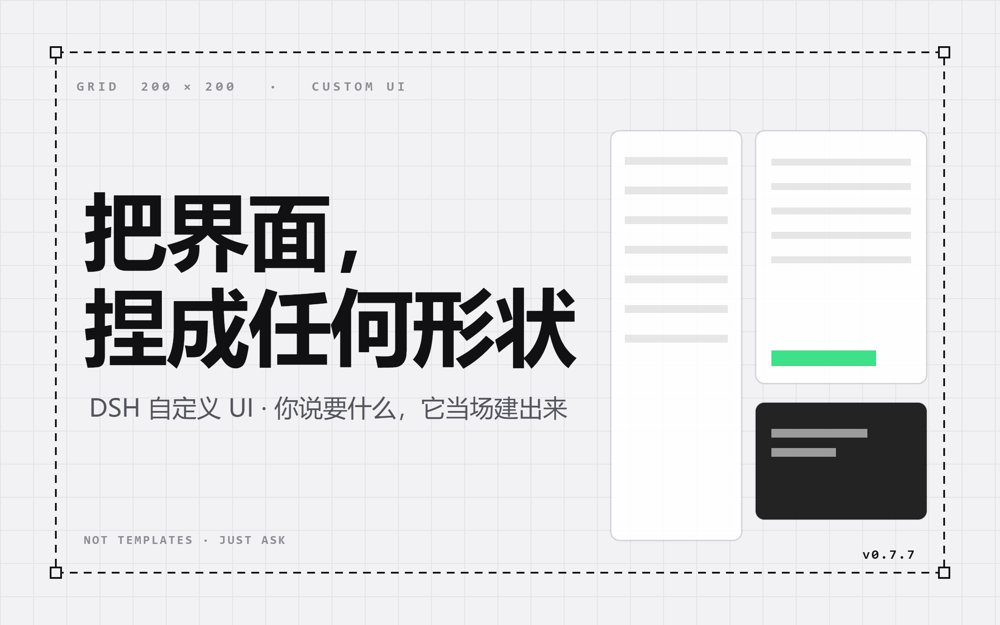

# dsh-grid-ui

[](https://github.com/twentytwohappy/dsh-grid-ui/actions/workflows/test.yml)
[](LICENSE)



让 DSH 的界面变成一块可以任意捏的液态画布：AI 通过工具在 **200 × 200 逻辑网格**上开窗、翻页、弹面板，窗口里可以是任意 HTML，也可以直接嵌一个网址；页面里的 JS 又能反过来驱动 DSH——切模型、调思考强度、改权限、发消息（还能带截图当附件）。

- 当前版本：**0.7.7**
- 形态：**Host 半插件 + 注入式浏览器 overlay**（不需要 Client 插件包，不需要重启应用即可刷新 overlay）
- 依赖服务：`webServer`、`tools`
- 运行环境：DSH Desktop 推荐（截图 / cookie 共享需要 Electron 主进程，见第 7 节）

---

## 目录

1. [能力总览](#1-能力总览)
2. [快速开始](#2-快速开始)
3. [核心概念](#3-核心概念)
4. [工具 API（给 AI 用）](#4-工具-api给-ai-用)
5. [窗口内容的两种来源：HTML / 网址](#5-窗口内容的两种来源html--网址)
6. [页面内 JS API：`dsh.*`](#6-页面内-js-apidsh)
7. [桌面级能力：截图与 cookie](#7-桌面级能力截图与-cookie)
8. [架构与数据流](#8-架构与数据流)
9. [坐标系统](#9-坐标系统)
10. [持久化与恢复](#10-持久化与恢复)
11. [配额与限制](#11-配额与限制)
12. [安全模型](#12-安全模型)
13. [快捷键](#13-快捷键)
14. [常见问题](#14-常见问题)
15. [测试](#15-测试)
16. [目录结构](#16-目录结构)
17. [变更记录](#17-变更记录)

---

## 1. 能力总览

| 能力 | 说明 |
| --- | --- |
| 🪟 任意窗口 | 7 个工具：建窗 / 改窗 / 删窗 / 建页 / 删页 / 开面板 / 关面板。窗口内容 = 任意 HTML（表单、图表、Canvas、滑块、视频……） |
| 📐 比例网格 | 200×200 格点，窗口按百分比定位，DSH 窗口缩放 / 分栏不跑偏 |
| 📄 多页画布 | 最多 20 页、每页 10 个窗口；页名自动编号、删页自动重排；悬浮球上翻页；切页时窗口保留（音频 / 定时器不断，最多缓存 40 个隐藏窗口） |
| 🔘 三种形态 | `window`（普通窗口）、`button`（悬浮按钮，点开面板）、`panel`（全屏面板） |
| 🌐 网址窗口 | 传 `url` 就把窗口变成浏览器（可嵌 B 站这类不设 `X-Frame-Options` 的站点，点链接在窗口内跳转，`⌂` 一键回起始页） |
| 🔌 反向控制 DSH | `dsh.setThinkingLevel` / `setModel` / `setPermission` / `sendMessage` / `cancelTurn` / 会话管理 |
| 🖼 图片附件 | `dsh.sendMessage(text, images)` 直接把图片当附件发给 AI |
| 📸 窗口截图 | `dsh.capture('win1')` 抓另一个窗口的画面（被遮挡也能抓），喂给输入框当附件 |
| 🍪 共享 cookie | 所有网址窗口与 `dsh.http` 共用同一份 cookie 罐（登录态一次搞定） |
| 🌍 网络代理 | `dsh.http(url)` 由 Host 代发请求，绕开浏览器 CORS 与页面 CSP |
| 👀 输出监看 | `dsh.getFeed()` 增量拿「用户说过什么、AI 回了什么、调了哪些工具、是否在忙」 |
| 📚 历史与附件 | `dsh.readHistory()` / `dsh.readAttachment()`，可在页面里做用量统计、聊天记录 |
| 💾 持久化 | 窗口、页、位置全部落盘，重启后自动装回 |
| ⌨️ 模式切换 | 悬浮球切换「自定义 UI / DSH 原版」，`Ctrl+Shift+R` 随时强制回原版 |

---

## 2. 快速开始

### 2.1 安装

插件有三种装法，挑一个能用的：

#### 方式 A：从 GitHub 直接装（推荐 · 目前走这条）

前提：本机有 `git`（`git --version` 能出版本号）。没有就装 [Git for Windows](https://git-scm.com/download/win)，装完**重开一个终端窗口**（PATH 才会更新）。

在 DSH 的**插件面板**里点「安装」，把下面这行粘进去：

```
github:twentytwohappy/dsh-grid-ui
```

或者用命令行（`<profile>` 换成你在用的 profile，桌面版一般是 `desktop`）：

```bash
dsh plugin --profile desktop add github:twentytwohappy/dsh-grid-ui
```

DSH 底层用 npm 安装，所以 npm 认的 spec 全都可用：

| 写法 | 含义 |
|---|---|
| `github:twentytwohappy/dsh-grid-ui` | 从 GitHub 拉最新 main |
| `github:twentytwohappy/dsh-grid-ui#v0.7.7` | 锁定某个 tag / 分支 / commit |
| `git+https://github.com/twentytwohappy/dsh-grid-ui.git` | 完整 git 地址 |
| `link:C:\path\to\dsh-grid-ui` | 本地目录软链（开发用） |

> **国内网络提示**：GitHub 拉取偶尔会卡住。如果失败，给 git 配代理（把端口换成你自己的）：
> ```bash
> git config --global https.proxy http://127.0.0.1:7897
> ```

#### 方式 B：npm（发布到 npm 之后可用）

```bash
dsh plugin --profile desktop add dsh-grid-ui
```

#### 方式 C：本地开发

```bash
dsh plugin --profile desktop add link:C:\path\to\dsh-grid-ui
```

#### 装完必做

1. **重启 DSH Desktop** —— `host/` 是 ESM 模块，热重载不会重新导入，必须整个应用重开
2. **刷新页面**（F5 / Ctrl+R）—— overlay 是通过 `webServer.tapIndex` 注入首页 HTML 的，只在新一次渲染时生效

> 只想改 `client/` 或 `styles/` 的话，不用重启应用，F5 就够。

### 2.2 三件套

1. **悬浮球**：右上角圆形按钮，蓝色 = 原版模式，绿色 = 自定义模式，下面的数字是「当前页窗口数 / 页号」。可以拖到任意位置（位置存 localStorage `dsh-grid-ui.ball-pos`），窗口缩放时自动拉回可见区；拖动与点击用 4px 位移阈值区分。
2. **让 AI 建窗口**：
   > 用 create_ui_window 在 (10,10) 到 (105,105) 建一个窗口，里面放一个调思考强度的滑块
3. **第一次出现窗口时自动进入自定义模式**（DSH 原版界面隐藏）。点悬浮球随时切回原版。

### 2.3 想用截图 / cookie 共享？

需要 Host 与 Electron 主进程同进程：

```powershell
# 设置一次，之后重启 DSH Desktop（从开始菜单启动，确保新进程继承环境变量）
setx DSH_DESKTOP_ISOLATED_HOST 0
```

启动后在日志里看到这行就说明生效了：

```
[dsh-grid-ui] cookie 共享已启用：网址窗口与 dsh.http 共用同一份 cookie 罐
```

---

## 3. 核心概念

### 3.1 网格

画面被抽象成 200 × 200 的逻辑格点，左上角 `(0,0)`、右下角 `(200,200)`。窗口由左上 `(gridX1, gridY1)` 与右下 `(gridX2, gridY2)` 定义，必须 `gridX2 > gridX1`、`gridY2 > gridY1`。

网格只用于坐标换算，**视觉上不画线**。

### 3.2 窗口

每个窗口是一条记录：

```js
{ id, kind, page, x1, y1, x2, y2, html, url, title, text, targetId, rev }
```

- `id`：唯一标识，字母/数字/下划线/点/冒号/中划线，≤ 64 字符
- `kind`：`window` | `button` | `panel`
- `page`：所在页（1 开始）
- `html` / `url`：二选一，见第 5 节
- `rev`：修订号，每次更新 +1

### 3.3 三种 kind

| kind | 行为 |
| --- | --- |
| `window` | 普通浮动窗口，直接渲染在画布上 |
| `button` | 画一个浮动按钮，点击后全屏弹出面板页（`targetId` 指向的 panel；不设时弹自己的 html） |
| `panel` | 平时不显示，只能被 button / `open_ui_panel` / 页面内 `dsh.openPanel(id)` 打开，打开时铺满窗口并带关闭按钮 |

> 面板不参与画布布局，也不显示在窗口列表里；`remove_ui_window` 可以删它。

### 3.4 页面

画布可以有多页（默认自动命名「第 1 页」「第 2 页」……）。

- 上限 20 页，每页上限 10 个窗口
- 删除页会连同页上的窗口一起删；**只剩一页时拒绝删除**
- 自动命名的页在增删后会重新编号（`第 4 页` → 删掉前面的页后变 `第 1 页`）
- 悬浮球左侧是页号，`▲ ▼` 翻页，`+` 新建页，中间的数字按钮是「窗口数 / 页数」

---

## 4. 工具 API（给 AI 用）

### 4.1 工具总览

| 工具 | 作用 | 必填参数 |
| --- | --- | --- |
| `create_ui_window` | 新建 / 覆盖一个窗口、按钮或面板 | `windowId`、`gridX1..gridY2` |
| `update_ui_window` | 部分更新（只传要改的字段） | `windowId` |
| `remove_ui_window` | 删除窗口 / 按钮 / 面板 | `windowId` |
| `create_ui_page` | 新建一页，可选命名 | — |
| `delete_ui_page` | 删除整页及其窗口 | `page` |
| `open_ui_panel` | 全屏打开一个面板 / 窗口 | `windowId` |
| `close_ui_panel` | 关闭当前全屏面板 | — |

### 4.2 `create_ui_window`

| 参数 | 类型 | 说明 |
| --- | --- | --- |
| `gridX1` `gridY1` `gridX2` `gridY2` | number | 格点坐标，`0..200` |
| `windowId` | string | 窗口唯一 ID |
| `html` | string | 窗口内容（完整 HTML 或 body 片段），与 `url` 二选一 |
| `url` | string | 网址窗口（http / https） |
| `kind` | `window` \| `button` \| `panel` | 默认 `window` |
| `page` | number | 放在第几页（1 开始，默认 1） |
| `title` | string | 仅用于标识，不显示在窗口里 |
| `text` | string | `kind=button` 时按钮上的文字（也用作面板标题默认值） |
| `targetId` | string | `kind=button` 时点击打开哪个面板 |

- 同一 `windowId` 重复创建会**覆盖**（`rev` 递增），不是报错。
- `kind=panel` 的窗口坐标会被强制成全屏 `(0,0)→(200,200)`。
- `kind=window` / `panel` 必须提供 `html` 或 `url` 之一。

### 4.3 `update_ui_window`

只传要改的字段即可：`html`、`url`、`kind`、`page`、`title`、`text`、`targetId`、`gridX1..gridY2`。

- 传 `html` 会清掉 `url`（反之亦然），内容来源始终只有一个。
- 网址窗口想改回 HTML：同时传 `url: ''` 和新的 `html`。

### 4.4 页面工具

```js
create_ui_page({ name: '数据看板' })   // 不传 name 则自动命名「第 N 页」
delete_ui_page({ page: 3 })            // 只剩一页时返回错误
```

### 4.5 面板工具

```js
open_ui_panel({ windowId: 'p_settings' })   // 只有 kind=panel 能被全屏打开
close_ui_panel()
```

页面内也可以：`dsh.openPanel(id)` / `dsh.closePanel()` / `dsh.getOpenPanel()`。

---

## 5. 窗口内容的两种来源：HTML / 网址

| | HTML 窗口 | 网址窗口 |
| --- | --- | --- |
| 参数 | `html` | `url` |
| 渲染方式 | iframe `srcdoc` | iframe `src` |
| sandbox | `allow-scripts allow-forms` | `allow-scripts allow-same-origin allow-forms allow-popups` |
| 页面里能用 `dsh.*` | ✅ | ❌（远程页面发的 `dsh-*` 消息会被忽略） |
| 能否读父页面 DOM | ❌（不透明源） | ❌（仍是独立文档） |
| 典型用途 | 自己的控件、图表、输入条 | 嵌 B 站、文档、内网系统 |

网址窗口的白屏基本只有两个原因：

1. 对方站点设了 `X-Frame-Options: DENY/SAMEORIGIN` 或 CSP `frame-ancestors`——浏览器层面就拒绝，插件绕不过；
2. 网址不是 http/https（`javascript:` / `data:` / `file:` 一律拒绝，`MAX_URL_LENGTH = 2048`）。

> 判断某站能不能嵌：`curl -I https://站点` 看有没有 `x-frame-options` / `content-security-policy: frame-ancestors`。B 站首页两个都没有，所以能嵌。

**网址窗口里的链接在哪里打开（v0.7.3）**：一律就地跳转，不再弹系统默认浏览器。DSH Desktop 自带的 window-open 处理器对 `window.open` / `target=_blank` 是「`shell.openExternal` + deny」，而网址窗口的 iframe 带 `allow-popups`，所以以前点链接会跑到系统浏览器。现在 Host 层装了重定向器：`wc.focusedFrame` 是某个网址窗口的子 frame 时，在该 frame 内执行 `location.assign(href)`；主界面、非网址窗口、`mailto:` 仍按原行为打开。

**迷路了怎么办**：每个网址窗口右上角有地址条（`⌂`），点它重建 iframe 并重新加载创建时传入的 `url`，等于「一键回到起始页」。地址条只在带 `url` 的窗口上出现，HTML 窗口没有。

---

## 6. 页面内 JS API：`dsh.*`

bridge 会被注入到每个 HTML 窗口的 `<head>`，页面里直接用 `window.dsh`。

### 6.1 全表

| API | 返回值 | 说明 |
| --- | --- | --- |
| `dsh.getState()` | `object \| null` | 同步返回最近一次状态快照（会话、当前模型、思考强度、权限、页、窗口数、能力清单） |
| `dsh.onState(fn)` | `() => void` | 订阅状态推送，返回退订函数 |
| `dsh.getCatalog()` | `object \| null` | 模型 / 权限 / 思考强度目录（Host 侧 30s 缓存） |
| `dsh.refreshCatalog()` | `Promise` | 强制刷新目录 |
| `dsh.toast(text)` | — | 顶部轻提示 |
| `dsh.setThinkingLevel(level)` | `Promise` | 设置思考强度（`off`/`low`/…，取值见 catalog） |
| `dsh.setModel(provider, model)` | `Promise` | 切换模型 |
| `dsh.setPermission(preset)` | `Promise` | 切换权限预设（`workspace-write` / `danger-full-access` …），结果里 `permissionConfirmed` 表示是否读回一致 |
| `dsh.sendMessage(text, images?)` | `Promise` | 发消息，`images: [{ data(裸 base64), mediaType, name? }]` |
| `dsh.cancelTurn()` | `Promise` | 中止当前回合 |
| `dsh.listSessions()` | `Promise` | 列出会话 |
| `dsh.newSession()` | `Promise<{sessionId}>` | 新建会话 |
| `dsh.renameSession(id, title)` | `Promise` | 重命名会话 |
| `dsh.searchSessions(query)` | `Promise` | 搜索会话 |
| `dsh.readHistory({maxMessages})` | `Promise` | 读最近 N 条事件（含 `usage`，可做用量统计） |
| `dsh.getFeed({since})` | `Promise<{seq, busy, items}>` | 增量拿 AI 输出监看流 |
| `dsh.readAttachment(attachmentId, sessionId?)` | `Promise` | 读附件 base64 |
| `dsh.http(url, options?)` | `Promise` | Host 代发 HTTP 请求 |
| `dsh.capture(windowId, options?)` | `Promise` | 截取另一个窗口的画面 |
| `dsh.cookie(options)` | `Promise` | 操作共享 cookie 罐 |
| `dsh.openPanel(id)` / `closePanel()` / `getOpenPanel()` | `Promise` | 控制全屏面板 |
| `dsh.film({page,spacing,hold,introMs,title,subtitle})` / `dsh.film({op:'stop'})` | `Promise` | 自动放映：引子 → 逐窗揭黑幕 → 自动翻页（详见第 17 节 v0.7.6） |
| `dsh.isFilming()` | `boolean` | 是否正在放映（读本地状态，不发请求） |
| `dsh.setSession(id)` / `getSessionId()` | `Promise` / `string` | 指定后续动作作用的会话 |
| `dsh.action(action, payload)` | — | 只发不等（底层通道） |
| `dsh.request(action, payload)` | `Promise` | 发一个动作并等结果 |

> 失败约定（v0.7.2 起）：Host 返回 `{ ok: false, error, code }` 时，对应 Promise **reject**，`error.code` 是稳定错误码。

### 6.2 控件三兄弟

```html
<select id="model"></select>
<div id="efforts"></div>
<div id="perms"></div>
<script>
  // catalog.models 是扁平数组：[{ provider, id, name, description?, inputModalities? }]
  const catalog = dsh.getCatalog() || {};
  const state = dsh.getState() || {};

  // 模型
  const sel = document.getElementById('model');
  for (const m of catalog.models || []) {
    const o = document.createElement('option');
    o.value = `${m.provider}::${m.id}`;
    o.textContent = m.name || m.id;
    if (state.activeModel && state.activeModel.model === m.id) o.selected = true;
    sel.appendChild(o);
  }
  sel.onchange = () => {
    const [provider, model] = sel.value.split('::');
    dsh.setModel(provider, model);
  };

  // 思考强度：当前模型支持的档位在 state.efforts 里（[{ id, name }]）
  for (const e of state.efforts || []) {
    const b = document.createElement('button');
    b.textContent = e.name || e.id;
    if (state.thinkingLevel === e.id) b.classList.add('on');
    b.onclick = () => dsh.setThinkingLevel(e.id);
    document.getElementById('efforts').appendChild(b);
  }

  // 权限：catalog.permissions = [{ value, name }]
  for (const p of catalog.permissions || []) {
    const b = document.createElement('button');
    b.textContent = p.name || p.value;
    if (state.permission === p.value) b.classList.add('on');
    b.onclick = async () => {
      const r = await dsh.setPermission(p.value);
      dsh.toast(r.permissionConfirmed ? '已切换' : '已切换（读回未确认）');
    };
    document.getElementById('perms').appendChild(b);
  }
</script>
```

### 6.3 发消息（带图片附件）

```js
// 纯文字
await dsh.sendMessage('帮我看看这个页面的问题');

// 带图片（base64，不带 data: 前缀也行，Host 会自动去掉）
const shot = await dsh.capture('win1', { format: 'jpeg', quality: 85, maxWidth: 1280 });
await dsh.sendMessage('这是窗口 1 的截图，里面有什么？', [
  { data: shot.data, mediaType: shot.mediaType, name: 'win1.jpg' }
]);
```

限制：单条消息最多 6 张、单张 base64 ≤ 12 MB。

### 6.4 AI 输出监看

Host 订阅了会话事件流，把 `user/message`、`assistant/message`（含 reasoning 与 tool-call）、`tool/result`、`turn/start|end`、`step/end`（token 数）、`approval/asked`、`llm/retry`、`goal/change` 收成一条条动态。

```js
let since = 0;
setInterval(async () => {
  const feed = await dsh.getFeed({ since });   // → { seq, busy, items }
  since = feed.seq;
  for (const item of feed.items) {
    // item.kind: user | assistant | tool | tool-result | turn | step | approval | error | goal
    console.log(item.kind, item.tool || '', item.text);   // tool 条目里 text 是调用参数
  }
  console.log(feed.busy ? 'AI 正在干活…' : '空闲');
}, 900);
```

环形缓冲：最多 120 条、单条文本 6000 字符、预览 700 字符、闲置 6 小时自动清。

### 6.5 网络代理

```js
const res = await dsh.http('https://api.bilibili.com/x/web-interface/popular?ps=8&pn=1', {
  method: 'GET',
  timeoutMs: 15000
});
const data = JSON.parse(res.body);   // res: { ok, status, statusText, headers, body, bytes, truncated, elapsedMs, finalUrl }
```

- 由 Host 用 Node 的 `fetch` 代发，**自动带上共享 cookie 罐**的 cookie，并把响应里的 `Set-Cookie` 收回罐里
- 默认 20s 超时（上限 60s）、响应最多 2 MB（`maxBytes` 可调小；超出 `truncated: true`）
- 允许自定义 `method` / `headers` / `body`，但 `host`、`content-length`、`connection` 等头会被拒绝

### 6.6 截图

```js
const shot = await dsh.capture('win1', { format: 'jpeg', quality: 85, maxWidth: 1280 });
// shot: { windowId, mediaType, data(base64), bytes, width, height, rect }
```

原理与限制见第 7 节。

### 6.7 cookie

```js
await dsh.cookie({ op: 'list', url: 'https://www.bilibili.com' });   // → { cookies: [...] }
await dsh.cookie({ op: 'set', url: 'https://example.com', name: 'k', value: 'v', path: '/', secure: true });
await dsh.cookie({ op: 'remove', url: 'https://example.com', name: 'k' });
await dsh.cookie({ op: 'clear' });
```

---

## 7. 桌面级能力：截图与 cookie

### 7.1 为什么需要单进程 Host

DSH Desktop 默认把插件 Host 放进**隔离子进程**（`--type=utility --utility-sub-type=node.mojom.NodeService`）。那里 `require('electron')` 拿不到 `BrowserWindow` / `session`，所以：

| 能力 | 隔离子进程 | 单进程（`DSH_DESKTOP_ISOLATED_HOST=0`） |
| --- | --- | --- |
| 网址窗口 / HTML 窗口 | ✅ | ✅ |
| `dsh.http`（含共享 cookie 罐） | ✅ | ✅ |
| `dsh.capture` 截图 | ❌ `grid-ui/no-electron` | ✅ |
| cookie 与 DSH 浏览器双向同步 | ❌（只有插件内部罐） | ✅（挂到 `session.webRequest`） |

开关只在启动时读一次，所以必须**完全退出 DSH 再从开始菜单启动**（`setx` 之后由 Explorer 拉起的进程才继承新环境变量）。

### 7.2 截图是怎么抓的

DSH Desktop 2.x 的主界面并不画在 `BrowserWindow.webContents` 上，而是挂在 `window.contentView` 里的 `WebContentsView`（`chromeView` 标题栏 + `content` 主内容）。对窗口自身的 webContents 调 `capturePage()` 只能拿到全透明空图——这是 v0.7.0/0.7.1 截图永远为空的根因。

现在的实现（`host/electron.js`）：

1. `candidateWindows()` 优先枚举 `win.contentView.children`，按面积从大到小得到候选 `webContents`；没有子视图时退回窗口自身的 webContents；
2. 对候选依次尝试 `capturePage(pixelRect)` → `capturePage()` 整页 + `crop()`；
3. 最多 3 轮（150 / 300 ms 退避），给首帧留时间；
4. 全失败时抛 `grid-ui/capture-empty`，错误信息里带每个候选的 `kind / visible / minimized / 尺寸`。

因为抓的是**整个渲染面**再按窗口百分比裁剪，所以窗口被别的窗口盖住也能截到它自己的画面。

### 7.3 cookie 罐

`host/cookies.js` 提供 `parseSetCookie()` / `CookieJar` / `attachSessionCookies()`：

- 所有网址窗口与 `dsh.http` 共用同一份罐（domain / path / secure / expires / sameSite 全部参与匹配）
- 单进程模式下还挂到 Electron `session.webRequest`：请求自动注入、响应 `Set-Cookie` 自动收集并回写 Chromium 的 cookie 存储
- 上限 2000 条、单条值 8192 字符，`Max-Age=0` / 过期时间到即删

---

## 8. 架构与数据流

```
┌───────────────────────── DSH Host 进程 ─────────────────────────┐
│  tools.register(create/update/remove_ui_window, pages, panel)    │
│           │ 写入                                                 │
│           ▼                                                      │
│  WindowRegistry（id → {kind,page,rect,html,url,title,rev}）      │
│           │ 写穿 sink（异步、串行、失败只吞）                     │
│           ▼                                                      │
│  storageDomain 领域 dsh_grid_ui / 表 windows + pages             │
│           ▼                                                      │
│  ~/.dsh/storages/dsh_grid_ui.json（启动时自动装回）               │
│                                                                  │
│  feed.js   会话事件流 → 环形缓冲（AI 输出监看）                   │
│  actions.js dsh-action 分发（22 项能力）                          │
│  catalog.js 模型 / 权限 / 思考强度目录（30s TTL）                 │
│  electron.js 截图 + 主窗口 session（需单进程）                    │
│  cookies.js 共享 cookie 罐                                        │
│           │ 读取                                                 │
│  webServer                                                        │
│    GET  /dsh-grid-ui/state     窗口 + 页 + DSH 状态快照           │
│    GET  /dsh-grid-ui/feed      AI 输出增量（?since=）             │
│    GET  /dsh-grid-ui/window    按需取单个窗口 HTML                │
│    POST /dsh-grid-ui/action    iframe 动作落点（22 项）           │
│    POST /dsh-grid-ui/remove    删除窗口                           │
│    POST /dsh-grid-ui/fetch     HTTP 代理（绕 CORS）               │
│    GET  /dsh-grid-ui/assets/*  grid.css / bridge.js               │
│    GET  /dsh-grid-ui/overlay.js overlay 脚本                      │
│    tapIndex → 往 index.html 注入 <script defer overlay.js>        │
└──────────────────────────────┬───────────────────────────────────┘
                               │ 同源 HTTP（700ms 轮询）
┌──────────────────────────────▼───────────────────────────────────┐
│ 浏览器（DSH Web 页面）                                             │
│  .dshgu-root（fixed inset:0；pointer-events:none）                │
│   ├─ .dshgu-grid     200×200 网格（纯 CSS，无 400 个 div）         │
│   ├─ .dshgu-windows  每窗 = fixed + 百分比定位 div                 │
│   │      └─ <iframe sandbox srcdoc|src>                          │
│   │             └─ bridge.js → window.dsh.*                       │
│   ├─ .dshgu-ball     悬浮球（永远显示、永远置顶、可拖动）           │
│   └─ .dshgu-panel    全屏面板层                                   │
└──────────────────────────────────────────────────────────────────┘
```

### 为什么不用 Client 插件包

当前 DSH 的静态 client bundle 只有 `window.__ModuleLoader__.load({id, factory(require)})` 形态，工厂函数拿不到 `host.call` / `harness.handle`，Host 与 Client 之间没有可用的自定义 RPC 通道。所以这里走的是「Host 暴露 HTTP 路由 + `tapIndex` 注入脚本」这条已验证的通道——和本 profile 里的 `dsh-whale-widget` 是同一套，稳定性好，改 overlay 也不用重启应用。

---

## 9. 坐标系统

```
left   =  gridX1 / 200 * 100%
top    =  gridY1 / 200 * 100%
width  = (gridX2 - gridX1) / 200 * 100%
height = (gridY2 - gridY1) / 200 * 100%
```

窗口容器是 `position: fixed`，DSH 窗口缩放 / 分栏变化时按比例跟随。给 AI 的窗口内建议：

- 图片用 `object-fit: contain` 保持等比
- 圆形元素用 `aspect-ratio: 1`
- 布局用 `%` / `flex`，别写死像素宽度

---

## 10. 持久化与恢复

- 介质：`storageDomain` 领域 `dsh_grid_ui`，表 `windows` + `pages`，落到 `~/.dsh/storages/dsh_grid_ui.json`
- 写入：窗口增删改都是**写穿**（先内存后异步落盘，串行、失败只吞）
- 恢复：启动时逐条 schema 校验，损坏 / 越界的记录被跳过并打日志，其余照常装回
- `rev`（修订号）跨重启保留

---

## 11. 配额与限制

| 项 | 值 |
| --- | --- |
| 网格 | 200 × 200 |
| 每页窗口数 | 10 |
| 页数 | 20（至少保留 1 页） |
| 单个窗口 HTML | 200 KB |
| 网址长度 | 2048 字符 |
| 消息图片 | 单条 6 张，单张 base64 ≤ 12 MB |
| `dsh.http` 超时 | 默认 20 s，上限 60 s |
| `dsh.http` 响应 | 2 MB（超出截断） |
| 监看流缓冲 | 120 条 / 单条 6000 字符 / 闲置 6 h |
| cookie 罐 | 2000 条 / 单值 8192 字符 |
| 状态轮询 | 700 ms（overlay）/ 30 s（catalog，可强制刷新） |
| 截图默认 | jpeg quality 85，maxWidth 1280 |

---

## 12. 安全模型

- **HTML 窗口**：`sandbox="allow-scripts allow-forms"`，**没有** `allow-same-origin` → 独立不透明源，读不到父页面 DOM / localStorage / cookie；只能通过 `postMessage` 走 bridge。
- **网址窗口**：`allow-scripts allow-same-origin allow-forms allow-popups`，但 `runtime.remote` 标记会拒绝它发来的 `dsh-*` 消息——远程页面无法驱动 DSH。
- **动作白名单**：所有动作都在 `host/actions.js` 的 `switch` 里，未注册的动作直接报错；`/state` 的 `capabilities` 字段列出当前全部 22 项。
- **URL 校验**：`assertUrl()` 用 `new URL()` 解析，只放行 http/https。
- **代理**：禁止伪造 `host` / `content-length` / `connection` 等头；响应大小与超时都有上限。
- **权限**：页面只能改成 catalog 里存在的预设，改完会读回校验（`permissionConfirmed`）。

---

## 13. 快捷键

| 快捷键 | 作用 |
| --- | --- |
| `Ctrl+Shift+R` | 强制切回 DSH 原版界面（捕获阶段拦截，焦点在 iframe 里也生效） |
| `Esc` | 关闭当前全屏面板 |
| `Enter`（输入条） | 发送消息，`Shift+Enter` 换行 |

---

## 14. 常见问题

**Q：网址窗口白屏？**
对方站点设置了 `X-Frame-Options` 或 CSP `frame-ancestors`，浏览器层面拒绝嵌入，插件无法绕过。换站点，或用 `dsh.http` 拿数据自己渲染。

**Q：`dsh.capture` 报 `grid-ui/no-electron`？**
Host 还在隔离子进程。设 `DSH_DESKTOP_ISOLATED_HOST=0`，**完全退出** DSH 后从开始菜单启动（`setx` 只对之后新建的进程生效）。

**Q：截图是空的 / 破图？**
v0.7.2 已修复（改抓 `contentView` 的子视图）。若仍出现，错误信息里会带候选的 `kind / visible / minimized / 尺寸`，据此判断是哪个窗口抓不到。

**Q：权限改了但界面跳回「工作区写入」？**
`set_permission` 会等会话投影刷新（轮询最多 600 ms）再读回，返回 `permissionConfirmed`。若为 `false`，说明 DSH 侧尚未生效；界面应以读回值为准，不要立即改回选中态。

**Q：窗口不显示？**
确认在自定义 UI 模式（点悬浮球），并且当前页号对得上（悬浮球上有页号）。

**Q：改了插件代码没生效？**
overlay / 样式改动刷新页面即可；Host 侧改动（`host/*.js`）必须重启 DSH。

**Q：插件列表显示「异常：Unexpected token … is not valid JSON」？**
有文件被写入了 UTF-8 BOM。用 `edit` 工具或 .NET `UTF8Encoding($false)` 重写，别用 PowerShell `Set-Content -Encoding UTF8`。

---

## 15. 测试

```bash
npm test
```

| 套件 | 覆盖 |
| --- | --- |
| `test/smoke.mjs` | 纯函数单测（坐标校验、sanitize、页命名、URL 校验等）29 项 |
| `test/cookies.mjs` | cookie 解析 / 匹配 / 过期 / 上限 33 项 |
| `test/host-smoke.mjs` | 用假 ctx 起插件，断言工具注册、路由（9 条）、动作分发、feed、权限兜底、截图错误路径、代理 |
| `test/storage-real.mjs` | 真 storageDomain + zod：读写、越界跳过、损坏恢复 6 项 |
| `test/persist-e2e.mjs` | 建窗 → 落盘 → 重启装回 → 删窗同步 20 项 |

---

## 16. 目录结构

```
dsh-grid-ui/
├── package.json            # 包信息 + dsh.bundle.patch 声明
├── cordis.patch.yml        # 挂载声明（插入 Host 根作用域）
├── host/
│   ├── index.js            # 入口：inject=['webServer','tools']，装配各模块
│   ├── tools.js            # 7 个工具的 schema 与实现
│   ├── windows.js          # 窗口 / 页注册表 + 坐标校验 + URL 校验 + 写穿 sink
│   ├── store.js            # 持久化（dsh_grid_ui 领域 / windows + pages）
│   ├── sanitize.js         # HTML 基础校验
│   ├── actions.js          # 22 项动作分发（模型/权限/消息/历史/feed/截图/cookie）
│   ├── feed.js             # 会话事件流 → 环形缓冲（AI 输出监看）
│   ├── catalog.js          # 模型 / 权限 / 思考强度目录（30s TTL）
│   ├── electron.js         # 截图 + 主窗口 session（需单进程 Host）
│   ├── cookies.js          # cookie 解析 / 罐 / session 桥
│   └── web.js              # 9 条 HTTP 路由 + tapIndex 注入
├── client/
│   ├── overlay.js          # 网格层 / 窗口层 / 悬浮球 / 面板 / 模式切换
│   └── bridge.js           # 注入到 iframe 的 window.dsh.*
├── styles/grid.css         # 全部样式（运行时注入 <style>）
├── demo/input-bar.html     # 示例：底部输入条
├── test/                   # 5 套测试
└── README.md
```

---

## 17. 变更记录

### v0.7.7

- **画布精简**：删掉第 7 页「04 失控的担心」（连同 5 个窗口），第 9 页还原成「只有标题栏 + 施工占位板」，等下一轮提示词再现场搭。全片现在 4 幕 8 页。
- **第 5 页补一块真窗口**：原来下方空着，现在放了 `b2_web`（grid `4,104 → 196,196` 的 B 站网址窗口），该页窗口数到 10/10 满额。
- **`b2_shot` 改成截这块新窗口**：以前它截的是第 1 页的 `win1`——而 `dsh.capture` 截的是「那个矩形当前显示出来的像素」，在第 5 页截 `win1` 的矩形，截到的其实是第 5 页自己的画面。现在改成 `dsh.capture('b2_web')`，按钮上还会显示返回的 `宽×高`。
- **配乐真正能听见了**：之前的配乐只存在于已删除的 `demo/film.html`，画布上的控制条一度根本没有发声代码。现在 `b1_ctl` 内置 WebAudio 合成器（D 多利亚音阶：低音正弦 + 三角波琶音 + 每 8 步换一次的和声垫，随放映进度由稀到密），点「开始放映」时借这次点击创建 `AudioContext`，另配 ♪ 开关与音量滑杆，放映结束/停止时淡出。
  - 为什么必须在控制条里建 `AudioContext`：浏览器只认「产生这次点击的那个 document」的用户手势；overlay 主文档没有手势，在它里面建 `AudioContext` 会一直 `suspended`，一点声音都没有。
  - 音符用 6 秒前瞻的调度器排出去，所以哪怕控制条所在 iframe 被 `display:none` 隐藏、定时器被节流到 1 秒，节奏也不会断。
- **`dsh.film()` 拒绝未知 op**：只有 `start` / `play` / `stop` / `state` 有效，拼错直接返回 `grid-ui/bad-film-op`，不会因为页面里敲错一个词就意外启动整片。
- **提示词闸门不再写死页号**：改成判断「本窗口此刻是否真的显示在屏幕上」（`getBoundingClientRect()` 有实际面积），删页、插页之后都不会错位。

### v0.7.6

- **放映模式 `dsh.film()`**：客户端内置一个播放引擎，不再靠页面自己算时间。
  - `dsh.film({ page, spacing, hold, introMs, title, subtitle })` 启动：先铺一层全屏「引子」字幕，再给当前页的每个窗口依次盖黑幕（`.dshgu-curtain`）→ 每隔 `spacing` 毫秒揭开一个（按「从上到下、从左到右」排序），最后一个揭开后停 `hold` 毫秒 → 自动翻到下一页，重复到最后一页自动停止。
  - `dsh.film({ op: 'stop' })` 立刻停止并揭开所有黑幕；`dsh.isFilming()` 读本地状态；`state.film = { on, spacing, hold }` 会随状态广播给页面。
  - 黑幕是「假实现」：iframe 早就在跑，只是被一块 `#0b0b0d` 盖住，到点淡出 0.55s——所以文字动画、音频、数据请求都是提前准备好的，揭开即完成。
  - 放映中点「▲ / ▼」手动翻页会重新给该页上幕并重置自动翻页计时，不会错乱。
- **宣传片重排为 4 幕 9 页**：第 4 页「01 把界面变成网格」（坐标沙盘 + 代码卡 + 参数表 + 悬浮球示意 + 放映控制条）、第 5 页「02 一个窗口一个能力」（定位、真实控件、输入条、截图、`dsh.http`、多页、按钮→面板，9 个窗口各演示一件事）、第 6 页「03 成品页」（8 个窗口拼出的工作台）、第 7 页「04 失控的担心」、第 8 页「03 一句提示词」（提示词 5 秒后自动发给 AI）、第 9 页「04 现场搭出来」（施工占位，随后被真实窗口替换）。
- **提示词自动发送的三重闸门**（防误触）：必须「正在放映」+「当前就停在第 8 页」+「已稳定停留 1.2 秒」同时成立才开始 5 秒倒计时；期间翻页、停止放映或点「取消发送」都会作废，发送成功后本窗口不会再发第二次。

### v0.7.5

- **翻页不再销毁窗口**：`gotoPage()` 不再 `teardownWindows()`，所有页的窗口都留在 DOM 里，非当前页用 `display:none` 藏起来。这样 iframe 里的音频、定时器、滚动位置、正在播放的动画在切页后都还在——「液态」翻页才真的顺手。
  - 只按需创建**当前页**的窗口：没去过的页不建 iframe，翻过去才创建，已经建好的切页后只隐藏。
  - 藏起来的窗口会吃内存，超过 `MAX_HIDDEN_WINDOWS = 40` 时按「最后隐藏时间」淘汰最老的（`evictHiddenWindows()`）。
  - 删页仍然走 `teardownWindows()`：页号会前移，重建比复用更稳。
- **宣传片重做**（第 4 – 8 页，28 个窗口）：每一幕拆成多个小窗口各演示一种能力（网格坐标沙盘、截图、`dsh.http`、控件、输入、翻页、组装动画、终端、权限乱跳、尾声清单），由第 4 页的 `a1_ctl` 控制条统一驱动：点「开始放映」后按幕调用 `dsh.page.next()` 自动翻页，同时用 WebAudio 实时合成各幕配乐（无音频文件）。控制条本身因为翻页保留窗口而一直活着。
- 删除旧的 `demo/film.html`（整屏单窗口版宣传片），宣传片现在完全由画布上的窗口组成。

### v0.7.4

- **v0.7.3 的外链重定向其实没装上**：插件激活时 DSH 主窗口往往还没布局完（`contentView.children` 的 bounds 还是 0×0，`getContentSize()` 也是 0），`candidateWindows()` 把所有候选都过滤掉了，`mainWebContents()` 返回 null，处理器压根没安装 —— 日志里那句 `网址窗口外链重定向未启用（找不到 DSH 主界面…）` 就是证据，所以点链接仍然弹系统浏览器。修法：
  - `candidateWindows()` 不再丢弃 0×0 的视图（尺寸延后到真正使用时用 `liveSize()` 现取，截图路径同样受益）；
  - `installWindowOpenRedirector()` 改成给**所有**候选 webContents 都装、并返回装了几个；
  - `attachWindowOpenRedirector()` 改为「立即尝试 + 退避重试（120ms…11s）+ `browser-window-created` 钩子 + 每 5s 巡检（最多 10 分钟）」，渲染进程重建或新开窗口后会自动补装。
- **焦点帧拿不到时的兜底**：`openerFrame()` 现在按「焦点子 frame → 与目标同 host 的 http(s) 子 frame → 唯一的 http(s) 子 frame」顺序挑发起帧，不再单纯依赖 `focusedFrame`。
- host-smoke 第 12 节由 5 项扩到 8 项（无焦点帧按唯一子 frame 跳转 / 纯 DSH 界面行为不变 / 多窗口按同源挑发起 frame）。

### v0.7.3

- **网址窗口里点链接不再弹系统浏览器**：DSH Desktop 自己的 window-open 处理器（`lib/electron-runtime-C_4WapB_.js:1983-1991`）对所有 `window.open` / `target=_blank` 一律 `shell.openExternal(url)` + deny，而网址窗口的 iframe 带 `allow-popups`，于是链接跑到默认浏览器。新增 `host/electron.js` 的 `createWindowOpenHandler()` / `installWindowOpenRedirector()`：用 `wc.focusedFrame` 判断发起方是不是某个网址窗口的子 frame，是则在该 frame 内 `location.assign(href)` 就地跳转；否则（主界面、非网址窗口、mailto）仍走 `shell.openExternal`。当前进程内所有 webContents 只 patch 一次（`WeakSet` 去重）。
- **网址窗口加地址条**：`⌂` 一键回到创建时传入的 `url`（`reopenRemote()` 重建 iframe 并重新 `src`），旁边显示当前站点 host；只在带 `url` 的窗口上出现。
- 新增 `demo/film.html` 宣传片（5 幕、约 90 秒、WebAudio 纯程序合成配乐、可自动放映）。
- host-smoke 第 12 节 5 项（子 frame 就地跳转 / 主 frame 仍外部打开 / mailto / `javascript:` 被拦 / 无 `executeJavaScript` 时退化）。

### v0.7.2

- **截图永远为空的真根因**：DSH Desktop 2.x 的界面不在 `BrowserWindow.webContents` 上，而在 `window.contentView` 的 `WebContentsView`（`chromeView` + `content`，见 `lib/electron-runtime-C_4WapB_.js:558-578`），对窗口自身 webContents 抓图只能得到透明空图。`candidateWindows()` 改为优先枚举子视图、按面积取主内容层，截图才真正可用。
- **截图兜底链**：`capturePage(pixelRect)` → 整页抓 + `crop()` → 3 轮退避（150/300 ms）；失败时错误信息带候选的 `kind / visible / minimized / 尺寸`。
- **失败不再被当成成功**：`postAction()` 对 `{ ok:false, error, code }` 抛带 `code` 的 Error（且不被外层「通信失败」文案覆盖），页面不会再拿 `{data: undefined}` 当附件发出去。
- 五套测试全绿。

### v0.7.1

- 截图改为枚举全部候选窗口 + 矩形直抓 + 整页裁切 + 重试；`dsh.capture()` 失败改为 reject。

### v0.7.0

- 新增 `dsh.capture(windowId, options)`：抓另一个窗口的画面，按百分比矩形裁剪，支持 png/jpeg、quality、maxWidth。
- 新增 `host/cookies.js` 与 `dsh.cookie()`：跨窗口共享 cookie 罐，`dsh.http` 自动带 cookie 并回收 `Set-Cookie`；单进程模式下挂到 `session.webRequest`。
- 能力清单扩到 22 项；新增 `DSH_DESKTOP_ISOLATED_HOST=0` 单进程开关（截图与 webRequest 需要它）。
- 新增 `test/cookies.mjs`（33 项）与 host-smoke 第 11 节（10 项）。

### v0.6.0

- 新增**网址窗口**：`create_ui_window` / `update_ui_window` 支持 `url`（只放行 http/https，上限 2048 字符），窗口变成 iframe `src` 模式并允许 `allow-same-origin`。
- 新增**网络代理** `dsh.http(url, options)` → `POST /dsh-grid-ui/fetch`：Host 用 Node 代发，绕开浏览器 CORS 与页面 CSP；返回 `{ok,status,headers,body,bytes,truncated,elapsedMs,finalUrl}`；默认 20s / 上限 60s / 2MB。
- 路由 8 → 9 条；README 增补 7.1 / 18.4 节。

### v0.5.1

- 修复 `read_history` 报 `session page through seq N is past cursor M`：`SessionHandle.seq` 可能领先于已落盘的最后一条，`readHistoryPage()` 会在 `past cursor` 时用真实光标重读一次。

### v0.5.0

- 新增**AI 输出监看**：`host/feed.js` 订阅会话事件流（user / assistant / tool / turn / step / approval / retry / goal），`GET /dsh-grid-ui/feed?since=` 增量返回，`dsh.getFeed()` 消费。
- 权限显示改为三级兜底：会话投影 → 最近一次成功写入的缓存 → 部署默认值；`set_permission` 不再因读回不一致抛错，改回 `permissionConfirmed`。

### v0.4.1

- 删页语义修正：只有「画布只剩一页」时才拒绝删除；自动命名的页在增删后重新编号。
- 悬浮球在单页时只显示 `1 页`，且隐藏翻页按钮。
- `open_panel` 增加 kind 守卫：只有 `kind=panel` 能被全屏打开。

### v0.4.0

- 新增**多页画布**（最多 20 页 / 每页 10 窗口）、页增删工具、悬浮球翻页。
- 新增 `kind`：`window` / `button` / `panel`；新增 `open_ui_panel` / `close_ui_panel` 与全屏面板层。
- 新增 `title` / `text` / `targetId` 字段。

### v0.3.x

- 窗口持久化：`storageDomain` 领域 `dsh_grid_ui`，写穿 sink + 启动恢复 + 损坏记录跳过；`rev` 跨重启保留。

### v0.2.x

- 输入条 demo、模型 / 权限 / 思考强度目录、图片附件发送、模式切换与 `Ctrl+Shift+R` 强制退出。

### v0.1.x

- 最小可用：200×200 网格 overlay、悬浮球（可拖动）、7 个工具中的建窗/改窗/删窗、动作分发、catalog、首页脚本注入。

---

## 18. 版本与依赖

- `dependencies`：`@deepseek-ai/dsh-storage-domain@0.2.0-rc.2`、`zod@^4.4.3`
- `peerDependencies`：`@deepseek-ai/cordis@~4.0.4`
- `inject`：`['webServer', 'tools']`
- 无 Client 插件包，无额外构建步骤

---

MIT © dsh-grid-ui
